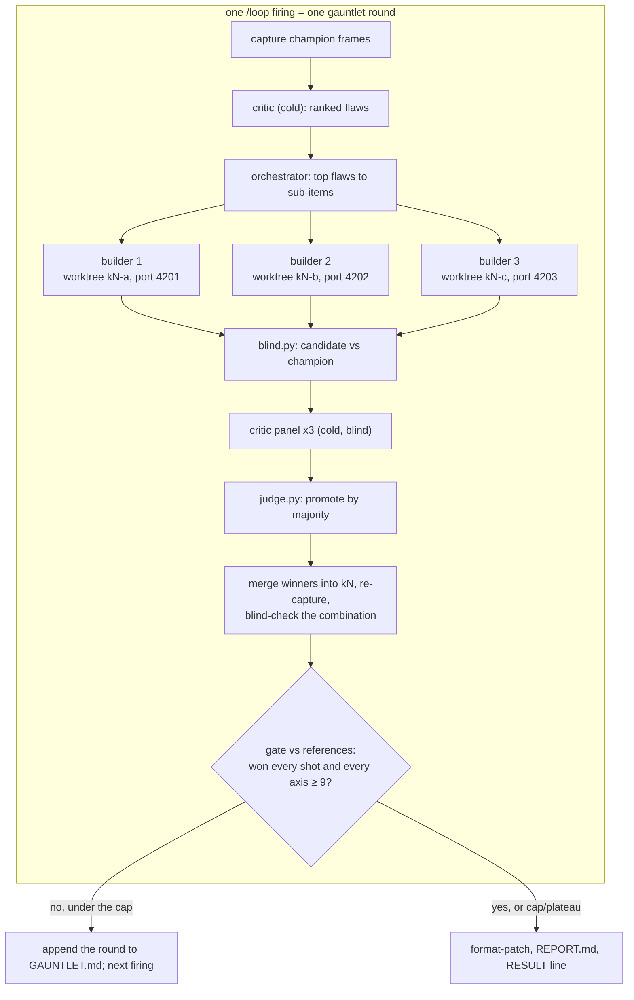

# Example: a AAA-grade Three.js shooter with gauntlet loops

This walkthrough uses the autonomous flow to build **Emberline**, an original first-person shooter, from a
blank folder to a polished vertical slice:

- **Client:** Three.js in the browser.
- **Server:** an [Agent-Lab](https://github.com/btech-software/agent-lab) backend that stores runs, serves the
  leaderboard and runs an AI *director* that shapes each wave.

The visual and game-feel work is driven by a **gauntlet loop**:

1. An orchestrating agent fans work out to builder subagents.
2. A separate, deliberately harsh critic judges every result from screenshots, *blind*. It does not know which
   image is the new one.
3. Changes are kept only when they win.
4. The loop repeats until the critic is "wowed" by a measurable bar, or the round cap stops it.

This example builds on two others:

- [EXAMPLE_AGENT_LAB.md](EXAMPLE_AGENT_LAB.md) for everything about the Agent-Lab server: scaffold, offline
  install, the K1 fix, and the patterns file.
- The [README](README.md) for the flow itself.

This file adds the client, the gauntlet machinery and the game's task queue.

> **Verified for this example:**
> - Three.js 0.187.0, Vite 8.3.5 and Playwright 1.64.1 with headless Chromium on SwiftShader.
>   - The capture harness renders shadows, a PMREM environment and bloom.
>   - Repeated captures of the same shot are byte-identical, including from parallel git worktrees.
> - The blind/judge scripts.
> - A WebSocket route mounted with `RouterMount` on Agent-Lab 1.17.12.
>
> The game content itself (art, animation, feel) is what the loop produces, so it cannot be verified ahead of
> time. See [What "AAA" means here](#what-aaa-means-here).

---

## From the gauntlet idea to the flow

The gauntlet idea, as usually stated, is a one-shot prompt:

- "build it at AAA quality"
- "fan out sub-agents"
- "/loop on each item"
- "a separate harsh critic checks it visually"
- "compare side by side, blind"
- "don't stop until the critic is utterly wowed"

Each of those ideas survives here. Each one is turned into something an unattended agent can actually run,
and that the lead can check afterwards:

| Gauntlet idea | How the flow runs it |
|---|---|
| "AAA quality, every single thing" | A list of **gauntlet items**, one task each (lighting, environment, weapon, enemies, VFX, HUD, feel, audio), plus a final whole-game gauntlet. Each item has a written rubric with anchored scores. |
| "Fan out sub-agents, one per item" | Inside a task, the orchestrator splits the critic's top flaws into sub-items. It gives each one to a **builder subagent** working in its own git worktree, on its own branch and port. |
| "/loop on each item" | A gauntlet task runs as a **self-paced `/loop`, one round per firing**. All round state is on disk in `reports/K<N>/GAUNTLET.md`, so a full context or a crash loses nothing. |
| "A separate sub-agent checks it visually, a harsh critic" | A **fresh critic subagent every round**, at the highest reasoning effort available. It sees only images and the rubric: no code, no builder notes, no history. |
| "Compare side by side, blind" | `blind.py` pairs candidate and champion frames under random A/B labels. The key is stored where the critic is told not to look. `judge.py` un-blinds the verdict. |
| "Compare against the real AAA game" | Comparisons are against **reference frames the lead owns or has licensed**: concept paintovers or the lead's own target renders, never another game's screenshots. Emberline is original IP. The bar is AAA *quality*, not a copy of someone's AAA *game*. |
| "Keep going until it is wowed" | A **gate**: the candidate beats the references in every shot *and* every rubric axis scores ≥ 9, judged by a majority of a three-critic panel. A **round cap** and a **plateau rule** (no promotion for two rounds) stop it otherwise. The RESULT line says honestly whether the gate passed. |
| "Utterly perfect" | Not a stopping condition. Things the critic can't see (frame rate on real GPUs, sound, how it plays) are marked **unchecked**, and the lead playtests them. |



---

## What gets built

| Task | Kind | Delivers |
|---|---|---|
| K1 | server | The scaffold's integration suite passing (the 401 fix from EXAMPLE_AGENT_LAB.md) |
| K2 | server | `RunStore` service and `POST /game/runs`, `GET /game/leaderboard` (in-memory) |
| K3 | memo | Where runs should be persisted in Agent-Lab's Postgres/Redis, with file:line evidence |
| K4 | server | `/live/ws` WebSocket for the director channel |
| K5 | server | `emberline_director`: a LangGraph agent that picks the next wave, with a deterministic fallback |
| K6 | client | Game skeleton: capture contract, named shots, seeded RNG, FPS controller, blockout map, budgets |
| K7 | client | Client ↔ server wiring: run submission, leaderboard screen, director over WebSocket with a local fallback |
| K10 | gauntlet G1 | Lighting, sky, shadows, post-processing |
| K11 | gauntlet G2 | Environment: materials, geometry detail, set dressing |
| K12 | gauntlet G3 | First-person weapon: viewmodel, animation, recoil, muzzle |
| K13 | gauntlet G4 | Enemies: models, animation, hit reactions, death |
| K14 | gauntlet G5 | VFX: tracers, impacts, smoke, decals, explosions |
| K15 | gauntlet G6 | HUD and menus |
| K16 | gauntlet G7 | Movement and combat feel (numeric tests and frame strips; the lead playtests) |
| K17 | non-visual | Audio: mixing, spatialisation, loudness checks (the critic can't hear; the lead listens) |
| K18 | gauntlet G8 | Whole-game gauntlet: every shot, full frames, against the references, within performance budgets |
| K19 | docs | README, controls, credits, how to run the gauntlet again |

K8 and K9 are left free for follow-ups the lead may want to insert before the gauntlets.

---

## Prerequisites (lead's machine)

- Everything in [EXAMPLE_AGENT_LAB.md](EXAMPLE_AGENT_LAB.md#prerequisites-leads-machine): uv, Docker, git.
- Node.js 22 and npm.
- A coding agent that can start subagents, such as Claude Code. Without subagents, everything still works
  sequentially: one builder at a time, and the critic as a separate fresh session.
- A machine with a real GPU for playtesting. The agent's frames come from a software renderer.
- **Art direction you own:** a short art bible and a reference frame for each named shot. These can be
  paintovers, concept art or a kitbash, but must be yours or licensed to you.
- **CC0 or properly licensed assets**, downloaded by you: HDRIs, PBR materials, rigged characters, a weapon
  model and sound effects. The agent is offline and can't fetch them.

---

## Phase 0: the monorepo (lead, online)

### 0.1 Layout

```
emberline/
  server/            Agent-Lab project from the cookiecutter template (package: emberline)
  client/            Vite + Three.js
    src/main.js      the game; capture mode is part of it
    src/rng.js       the only randomness source
    src/shots/       named camera shots for the gauntlet
    tools/capture.mjs
    test/            node --test unit tests (pure logic: movement curves, wave tables, ...)
  tools/gauntlet/    blind.py, judge.py: owned by the lead, the agent never edits them
  art/               BIBLE.md, RUBRIC.md, BUDGETS.md, refs/<shot>.png: owned by the lead
```

`art/` and `tools/gauntlet/` are committed, so they're versioned with the game. The agent may read them but
not edit them. A loop that can rewrite its own judge or its own bar would optimise the judge, not the game.

### 0.2 Server

Follow [EXAMPLE_AGENT_LAB.md Phase 0](EXAMPLE_AGENT_LAB.md#phase-0-scaffold-the-project-lead-online), but bake
into `server/`:

```bash
mkdir -p ~/code/emberline && cd ~/code/emberline
uvx cookiecutter gh:btech-software/agent-lab --directory cookiecutter --output-dir . \
  --no-input project_name="Emberline" description="Game backend: runs, leaderboard, AI director" \
  author_name="Your Name" author_email="you@example.com" \
  include_docker=true include_github_actions=true include_testcontainers=true
mv emberline server
(cd server && uv lock && uv sync --group dev --group test && make lint test_unit)
```

The fresh scaffold's integration suite fails with a 401, the same as in the Agent-Lab example. That becomes K1.

### 0.3 Client

```bash
mkdir -p client && cd client
npm init -y && npm pkg set type=module
npm i -E three@0.187.0
npm i -D -E vite@8.3.5 playwright@1.64.1
npm pkg set scripts.build="vite build" scripts.test="node --test 'test/*.test.js'" \
            scripts.capture="node tools/capture.mjs"
printf 'node_modules/\ndist/\n' > .gitignore
```

Node 22's `node --test` needs the quoted glob. A bare directory argument fails with `MODULE_NOT_FOUND`.

**The capture contract.** Every gauntlet comparison depends on the game rendering *exactly* the same frame
for the same URL. Capture mode is part of the game, and K6 must keep this contract. A minimal working
`src/main.js` that keeps it (the blockout below) looks like this:

```js
const q = new URLSearchParams(location.search);
const capture = q.has('shot');                 // capture mode: fixed clock, one frame, no input
const shot = SHOTS[q.get('shot') ?? 'courtyard_dusk'];
const seed = Number(q.get('seed') ?? 1);
const fixedT = Number(q.get('t') ?? 0);
const rand = rng(seed);                        // never Math.random()

const renderer = new THREE.WebGLRenderer({ antialias: true, preserveDrawingBuffer: capture });
renderer.setPixelRatio(capture ? 1 : devicePixelRatio);
// ... scene, lights, PMREM environment, EffectComposer with RenderPass, UnrealBloomPass, OutputPass ...

if (capture) {
  update(fixedT);
  renderer.info.autoReset = false; // the composer renders several passes; count them all
  renderer.info.reset();
  composer.render();
  const i = renderer.info.render;
  window.__stats = { calls: i.calls, triangles: i.triangles, textures: renderer.info.memory.textures };
  window.__ready = true;
} else {
  renderer.setAnimationLoop((ms) => { update(ms / 1000); composer.render(); });
}
```

Without `autoReset = false`, `renderer.info` reports only the composer's last full-screen pass (1 call,
1 triangle). With it, the blockout reports 75 calls and 736 triangles.

`src/rng.js` (mulberry32):

```js
export function rng(seed) {
  let a = seed >>> 0;
  return () => {
    a = (a + 0x6d2b79f5) >>> 0;
    let t = a;
    t = Math.imul(t ^ (t >>> 15), t | 1);
    t ^= t + Math.imul(t ^ (t >>> 7), t | 61);
    return ((t ^ (t >>> 14)) >>> 0) / 4294967296;
  };
}
```

`src/shots/index.js`:

```js
// Named camera shots the gauntlet captures. Add shots; never change an existing one
// (champion frames in reports/ were captured with it).
export const SHOTS = {
  courtyard_dusk: { pos: [6, 1.7, 8], look: [0, 1, 0] },
  alley_low: { pos: [-3, 0.4, 4], look: [0, 1.2, -2] },
};
```

### 0.4 The capture harness: `client/tools/capture.mjs`

It builds the client, serves it with `vite preview` on `PORT`, renders each named shot in headless Chromium on
SwiftShader, and writes `<shot>.png` plus `stats.json`. `stats.json` holds the draw calls, triangles, textures,
a short sha256 and any page errors. The script exits non-zero if the page logged an error.

```js
// Deterministic frame capture for the gauntlet.
// node tools/capture.mjs <outdir> <shot> [<shot> ...]   (env SEED, T, W, H, PORT)
import { mkdirSync, writeFileSync } from 'node:fs';
import { createHash } from 'node:crypto';
import { build, preview } from 'vite';
import { chromium } from 'playwright';

const [outdir, ...shots] = process.argv.slice(2);
const seed = process.env.SEED ?? '1', t = process.env.T ?? '0';
const port = Number(process.env.PORT ?? 4173);
const width = Number(process.env.W ?? 1280), height = Number(process.env.H ?? 720);
mkdirSync(outdir, { recursive: true });

await build({ logLevel: 'warn' });
const server = await preview({ preview: { port, strictPort: true, host: '127.0.0.1' } });
const browser = await chromium.launch({ args: ['--use-angle=swiftshader', '--enable-unsafe-swiftshader'] });
const page = await browser.newPage({ viewport: { width, height } });
const errors = [];
page.on('pageerror', (e) => errors.push(String(e)));
page.on('console', (m) => m.type() === 'error' && errors.push(m.text()));

const stats = {};
for (const shot of shots) {
  await page.goto(`http://127.0.0.1:${port}/?shot=${shot}&seed=${seed}&t=${t}`);
  await page.waitForFunction(() => window.__ready === true, null, { timeout: 60000 });
  const png = await page.locator('canvas').screenshot();
  writeFileSync(`${outdir}/${shot}.png`, png);
  stats[shot] = { ...(await page.evaluate(() => window.__stats)),
    sha256: createHash('sha256').update(png).digest('hex').slice(0, 16) };
}
writeFileSync(`${outdir}/stats.json`, JSON.stringify({ seed, t, width, height, stats, errors }, null, 2));
await browser.close();
server.httpServer.close();
if (errors.length) { console.error(errors.join('\n')); process.exit(1); }
console.log(JSON.stringify(stats));
```

**Why SwiftShader:** a software renderer gives the same pixels on every run and every machine, which is what
blind comparison needs. Two captures of the blockout gave identical hashes. The frames are for *comparison*;
the final look is confirmed on a real GPU by the lead.

**Motion:** the critic only sees stills, so motion is captured as a **frame strip**: the same shot at several
fixed times, read in order.

```bash
for t in 0 0.05 0.1 0.15 0.2 0.25; do T=$t npm run capture -- ../caps/strip-$t weapon_fire; done
```

### 0.5 The blind tools: `tools/gauntlet/` (lead-owned)

`blind.py` pairs each candidate frame with the matching baseline frame under random labels:

```python
"""Pair candidate frames with baseline frames under random A/B labels.

python3 tools/gauntlet/blind.py <baseline_dir> <candidate_dir> <pairs_dir> <key_file>

The critic sees only <pairs_dir>. <key_file> records which side is the candidate
and must live where the critic is told not to look (reports/K<N>/keys/).
"""

import json
import secrets
import shutil
import sys
from pathlib import Path

baseline, candidate, pairs, key_file = map(Path, sys.argv[1:5])
key = {}
for cand in sorted(candidate.glob("*.png")):
    base = baseline / cand.name
    if not base.exists():
        sys.exit(f"no baseline frame for {cand.name}")
    side = secrets.choice("AB")
    other = "B" if side == "A" else "A"
    out = pairs / cand.stem
    out.mkdir(parents=True, exist_ok=True)
    shutil.copyfile(cand, out / f"{side}.png")
    shutil.copyfile(base, out / f"{other}.png")
    key[cand.stem] = side
key_file.parent.mkdir(parents=True, exist_ok=True)
key_file.write_text(json.dumps(key, indent=2))
print(f"{len(key)} pairs in {pairs}")
```

`judge.py` un-blinds one critic verdict:

```python
"""Un-blind a critic verdict and decide promotion and the gate.

python3 tools/gauntlet/judge.py <key_file> <verdict.json> [--gate MIN_SCORE]

verdict.json, written by the critic:
  {"<shot>": {"winner": "A" | "B",
              "scores": {"A": {"<axis>": 0-10, ...}, "B": {...}},
              "worst_flaw": {"A": "...", "B": "..."}}}

Exit 0 and "PROMOTE" when the candidate wins a strict majority of shots.
With --gate, also prints "GATE PASS" only if the candidate won every shot
and every one of its axis scores is >= MIN_SCORE.
"""

import json
import sys
from pathlib import Path

key = json.loads(Path(sys.argv[1]).read_text())
verdict = json.loads(Path(sys.argv[2]).read_text())
gate = float(sys.argv[sys.argv.index("--gate") + 1]) if "--gate" in sys.argv else None

if set(verdict) != set(key):
    sys.exit(f"verdict shots {sorted(verdict)} != key shots {sorted(key)}")

wins, lowest, rows = 0, 10.0, []
for shot, side in sorted(key.items()):
    v = verdict[shot]
    won = v["winner"] == side
    wins += won
    scores = v["scores"][side]
    low_axis = min(scores, key=scores.get)
    lowest = min(lowest, scores[low_axis])
    rows.append(f"{shot}: {'won' if won else 'lost'}; lowest {low_axis}={scores[low_axis]}; "
                f"flaw: {v['worst_flaw'][side]}")

print("\n".join(rows))
print(f"candidate won {wins}/{len(key)}; lowest axis score {lowest}")
promote = wins * 2 > len(key)
print("PROMOTE" if promote else "KEEP CHAMPION")
if gate is not None:
    print("GATE PASS" if wins == len(key) and lowest >= gate else "GATE FAIL")
sys.exit(0 if promote else 1)
```

Sample output, for a candidate that wins but isn't good enough yet:

```
alley_low: won; lowest materials=6; flaw: untextured boxes
courtyard_dusk: won; lowest materials=6; flaw: untextured boxes
candidate won 2/2; lowest axis score 6
PROMOTE
GATE FAIL
```

Run both with `python3 -I` (stdlib only, no project imports).

### 0.6 Art direction (lead-owned, in `art/`)

- **`BIBLE.md`:** one page covering:
  - setting: a refinery district at dusk, near future
  - palette: warm sodium lights against cold blue shadow
  - materials: wet concrete, painted steel, sun-bleached signage
  - mood references described in words
  - the forbidden list: no other game's logos, characters, weapons-by-trademark or UI layouts
- **`refs/<shot>.png`:** one target frame per named shot, the same size as the captures (1280×720). These are
  the "AAA" bar the gate compares against.
- **`RUBRIC.md`:** the axes each gauntlet item is scored on, with *anchored* scores so a critic's "9" means
  something. For example, for G1 lighting:

  | Axis | 3 | 6 | 9 | 10 |
  |---|---|---|---|---|
  | `light_quality` | flat ambient, no key light | readable key/fill, hard shadow edges | soft contact shadows, bounce, believable falloff | indistinguishable from an offline render |
  | `atmosphere` | none | uniform fog | height fog, light shafts, depth layering | the air itself tells the time of day |
  | `exposure_color` | clipped or muddy | correct but generic | graded to the bible's palette, no clipping | cinematic grade, consistent across shots |
  | `artifacts` | acne, peter-panning, banding everywhere | visible in some places | none visible at 1280×720 | none visible at 2× zoom |

  Write one table per item: G1–G7, plus a whole-game table for G8.
- **`BUDGETS.md`:** hard limits checked from `stats.json`. For example: draw calls ≤ 600, triangles ≤ 2.5 M,
  textures ≤ 120 per shot, and a production build ≤ 25 MB gzip excluding audio. A candidate over budget is
  not promoted, however good it looks.

### 0.7 Assets

Put licensed assets under `client/public/assets/` with a `CREDITS.md` that lists each file, its source and its
licence. Raw downloads the agent may draw from go in the workspace's `inputs/assets/` (Phase 1). Keep
asset-pipeline CLIs, such as a glTF optimiser, as exact-pinned `devDependencies` so they work offline.

### 0.8 Commit the baseline

```bash
cd ~/code/emberline
cat > .gitignore <<'EOF'
.DS_Store
caps/
EOF
git init -b main && git add -A && git commit -m "Scaffold Emberline: Agent-Lab server, Three.js client, gauntlet tools"
```

---

## Phase 1: offline workspace (lead, online)

```bash
cd ~/dev/autonomous-flow
./new-workspace.sh ~/agents/emberline ~/code/emberline main
cd ~/agents/emberline
git -C repo config user.name "emberline-bot"; git -C repo config user.email "bot@invalid"

# server: same as EXAMPLE_AGENT_LAB.md 1.2-1.5
(cd repo/server && uv sync --frozen --group dev --group test && UV_OFFLINE=1 make lint test_unit)
docker pull pgvector/pgvector:pg16; docker pull redis:alpine
docker pull hashicorp/vault:1.18.1; docker pull testcontainers/ryuk:0.8.1

# client: dependencies and a headless browser inside the workspace
(cd repo/client && npm ci)
(cd repo/client && PLAYWRIGHT_BROWSERS_PATH=$PWD/../../.pw-browsers npx playwright install --only-shell chromium)

# smoke test, with the network off: must print stats and write two PNGs
(cd repo/client && PLAYWRIGHT_BROWSERS_PATH=$PWD/../../.pw-browsers \
   npm run capture -- ../../reports/K0/baseline courtyard_dusk alley_low && npm test)

# raw assets and framework notes
mkdir -p inputs/assets inputs/agent-lab
cp -R ~/assets/emberline/* inputs/assets/      # your licensed downloads + their LICENSES.md
# + DEV_GUIDE.md etc. and PATTERNS.md as in EXAMPLE_AGENT_LAB.md 1.5
```

The headless shell is about 200 MB. Installing it in the workspace (`.pw-browsers/`) rather than the user
cache means the agent never needs to download a browser. It also means that a Playwright upgrade elsewhere
can't break the agent's captures. If the browser is missing, Playwright prints
`Executable doesn't exist ... run npx playwright install`.

**Worktrees and `node_modules`.** Builder subagents work in git worktrees, which don't contain the ignored
`node_modules`. Each builder symlinks the main clone's copy. This was verified with two builders capturing in
parallel on ports 4201 and 4202, and both produced the same hash:

```bash
git -C repo worktree add ../wt/k10-fog -b k10-fog k10
ln -s ../../../repo/client/node_modules wt/k10-fog/client/node_modules
```

---

## Phase 2: BRIEF.md

Start from the Agent-Lab brief in
[EXAMPLE_AGENT_LAB.md Phase 2](EXAMPLE_AGENT_LAB.md#phase-2-briefmd-for-an-agent-lab-project). Make these
changes:

- Replace the project paragraph.
- Prefix the server commands with `server/`.
- Add the client and gauntlet sections below.

```markdown
# Brief: Emberline

You help build Emberline, an original first-person shooter: a Three.js client (client/) and an Agent-Lab
server (server/, Python 3.12, FastAPI, LangGraph). The lead gives you tasks in TASKS.md and reviews everything
before it goes anywhere. Emberline is original IP: never reproduce another game's names, characters, logos,
maps, UI layouts or trademarked weapon names, even if an input mentions one.

Workspace: this folder. repo/ is a local copy of main with no remote. Write only inside this folder.

## Rules
(the Rules section from the Agent-Lab brief, unchanged)

## Environment
- Server: UV_OFFLINE=1 always; checks from repo/server: make lint, make test_unit, make test_integration.
  Docker only through the integration tests (ports 15432, 16379, 18200).
- Client: export PLAYWRIGHT_BROWSERS_PATH=<workspace>/.pw-browsers. Checks from repo/client: npm test,
  npm run build, npm run capture -- <outdir> <shots...>. Never npm install, npm ci, npx <anything not in
  node_modules/.bin>, or playwright install. If a task needs a new package, BLOCKED with the package and why.
- Ports: capture uses PORT; the main session uses 4173, builder i uses 4200+i. Never other ports.
- No network, no real LLM calls (fake chat model in tests), no gh/push/fetch/curl.

## Client rules
- Keep the capture contract (client/src/main.js): ?shot=&seed=&t= renders one deterministic frame, sets
  window.__stats and window.__ready. Never use Math.random(), Date.now() or performance.now() in anything
  that affects a captured frame; use src/rng.js and the fixed clock.
- Never change an existing entry in src/shots/index.js; add new shots instead.
- Pure logic (movement curves, wave tables, damage, scoring) lives in modules with node --test tests.
- Assets: copy only from inputs/assets/, list every file in client/public/assets/CREDITS.md with source and
  licence. No asset without a licence entry.
- Stay within art/BUDGETS.md in every captured shot (stats.json).

## Gauntlet rules (tasks marked "gauntlet")
- repo/art/ and repo/tools/gauntlet/ are read-only for you and for every subagent. Never edit the rubric,
  the references, the budgets or the judge.
- One /loop firing runs one round, exactly as in inputs/GAUNTLET_ROUND.md. All round state goes to
  reports/<task>/GAUNTLET.md; read its tail first.
- You orchestrate; you do not judge. Never look at candidate or reference images yourself and never write a
  verdict. Critics are fresh subagents with only the pairs folder, the rubric and inputs/CRITIC.md.
- Keys (reports/<task>/keys/) are never shown or described to a critic or a builder.
- Promotion is only what judge.py says, by majority of a three-critic panel. A candidate over budget, with
  page errors, or with failing tests is never promoted.
- Stop when the gate passes, or at the task's round cap, or after two rounds with no promotion. Then deliver
  the champion as usual and state in the RESULT line whether the gate passed, the last judge.py lines, and
  what the critics still flag.
- Builder branches are kept for audit (k<N>-<item>); remove their worktrees after the round.
```

### `inputs/CRITIC.md`: the critic's standing prompt

Each critic is started fresh with this text, the task's rubric table and the path of one pairs folder:

```markdown
You are a senior art director at a top studio reviewing frames for a AAA first-person shooter. You are hard to
impress. Your reputation depends on never passing work that would embarrass the studio at launch.

You get folders <shot>/A.png and <shot>/B.png. You do not know how either image was made or which one is
newer, and you must not try to find out: read only the files you were given, nothing else on disk.

For every shot:
1. Look at A and B at full size. Describe what you see in each in two sentences, before judging.
2. Score each image 0-10 on every rubric axis, using the anchors exactly. A 9 means the anchor text for 9 is
   fully true. If you hesitate between two scores, give the lower one.
3. Name the single worst flaw of each image, concretely enough that an artist could fix it (where in the
   frame, what is wrong, what it should look like).
4. Pick the winner. A tie is not allowed. If they are equally bad, pick the one with the less severe worst
   flaw.

Write only verdict.json in the format below to the path you were given, then stop. Do not praise. Do not
suggest that something is "good enough". Do not soften scores to be encouraging.

{"<shot>": {"winner": "A"|"B", "scores": {"A": {...}, "B": {...}},
            "worst_flaw": {"A": "...", "B": "..."}}}
```

For the flaw-finding critic at the start of a round, which sees only the champion, use the same persona.
Instead of the pair steps, ask for the ten worst flaws across all shots, ranked by how much each one hurts
the AAA impression. Each flaw names the shot and the area of the frame. The output is `critique.md`.

### `inputs/GAUNTLET_ROUND.md`: what one round does

```markdown
One gauntlet round for task K<N> (read the task for: item, shots, rubric table, round cap, gate).
State: reports/K<N>/GAUNTLET.md. Champion: branch k<N> (created from the task's base in round 1).

1. Read the tail of GAUNTLET.md. If it says DONE, append IDLE-for-this-task to it and stop this firing.
2. Capture the champion: npm run capture -- ../../reports/K<N>/r<R>/champion <shots>. Check stats.json
   against art/BUDGETS.md and that errors is empty.
3. Flaw pass: start one fresh critic subagent with inputs/CRITIC.md (flaw mode), the rubric table and
   reports/K<N>/r<R>/champion/*.png. It writes reports/K<N>/r<R>/critique.md.
4. Take the top 3 flaws that are within this task's item. For each, start one builder subagent in its own
   worktree (git worktree add ../wt/k<N>-<slug> -b k<N>-<slug> k<N>; symlink node_modules; PORT=4200+i).
   A builder gets: the flaw text, BRIEF.md's client rules, art/BIBLE.md, the files likely involved, the
   budgets. It must: change only what the flaw needs, run npm test, capture the task's shots into
   reports/K<N>/r<R>/<slug>/, keep within budget, commit once on its branch, and report in 5 lines.
   Builders never see critique scores for other flaws, the keys, or the references.
5. For each builder with green tests, no page errors and in budget:
   blind.py champion <slug> reports/K<N>/r<R>/pairs-<slug> reports/K<N>/keys/r<R>-<slug>.json
   Start three fresh critics on pairs-<slug>, each writing its own verdict-<slug>-<c>.json.
   judge.py on each; the candidate is promoted if at least two of three print PROMOTE.
6. Merge every promoted branch into k<N> (git merge --no-ff; on a conflict, keep the first and drop the
   later one for this round). If more than one merged, capture again and run step 5 with "combined" vs
   the round's champion; if it loses, reset k<N> to the best single promotion (git reset only on k<N>,
   only to a commit made in this round).
7. Gate: blind.py repo/art/refs reports/K<N>/r<R>/final reports/K<N>/r<R>/pairs-ref keys/r<R>-ref.json,
   three fresh critics, judge.py --gate 9 on each. Gate passes if at least two of three print GATE PASS.
8. Append one row to GAUNTLET.md:
   | r<R> | flaws tried | promoted | panel votes | gate votes | lowest axis | budgets (calls/tris) |
9. If the gate passed, or R equals the round cap, or rounds R-1 and R promoted nothing: append DONE and do
   the normal delivery (format-patch, REPORT.md with the GAUNTLET.md table and the final frames' paths,
   RESULT line). Otherwise end this firing; the next firing does round R+1.
```

---

## Phase 3: the task queue

The server and skeleton tasks are ordinary flow tasks. The gauntlet tasks name their item, shots, rubric
table, round cap and gate. Everything else is in `GAUNTLET_ROUND.md`.

```markdown
## K1 (now; lead, 2026-11-09 09:00 UTC): the server's integration suite fails with 401
As K1 in EXAMPLE_AGENT_LAB.md, in repo/server. Branch k1 from main. RESULT line.

## K2 (after K1; lead, 2026-11-09 09:00 UTC): runs and leaderboard API
Branch k2 from k1. A RunStore service on the container (in-memory for now, behind a small interface:
add(run) -> id, top(n) -> list). Routes via RouterMount at /game:
POST /game/runs {player: str 1-24 chars, seed: int, score: int >= 0, duration_s: float > 0, wave: int >= 1}
-> {id, rank}; GET /game/leaderboard?n=10 -> [{player, score, wave}], highest score first, ties by shorter
duration. Reject a score above 5000 * wave (422) as an obvious-cheat guard. Unit tests for the service and
both routes (no Postgres). RESULT line.

## K3 (now, read-only; lead, 2026-11-09 09:00 UTC): where should runs be persisted?
No code. Read the Agent-Lab sources in repo/server/.venv and the template's config: which Postgres
databases, Redis access and migrations exist, and how an extra service would reach them. Write
reports/K3/MEMO.md: two options with file:line evidence, the test story for each under testcontainers, and a
recommendation. RESULT line.

## K4 (after K2; lead, 2026-11-09 09:00 UTC): the director channel
Branch k4 from k2. WebSocket at /live/ws via RouterMount (pattern below). Messages are JSON with a seq:
client -> {"seq", "type": "wave_end", "wave", "telemetry": {accuracy, damage_taken, time_s, deaths}};
server -> {"seq", "type": "next_wave", "wave", "plan": {...}, "source": "director" | "fallback"}.
For now plan comes from a deterministic WaveTable service on the container (wave n: count, mix, spawn
points chosen from the telemetry with fixed rules). Unit tests with TestClient.websocket_connect. RESULT line.

## K5 (after K4; lead, 2026-11-09 09:00 UTC): emberline_director agent
Branch k5 from k4. An LLM-backed LangGraph agent (WorkflowAgentBase, like the template's react_agent) that
takes the telemetry and the WaveTable's plan and returns an adjusted plan in a strict JSON schema, plus one
radio callout line (<= 80 chars, original wording). Validate the output; anything invalid or slower than
the configured timeout (default 300 ms) falls back to the WaveTable plan with source "fallback". /live/ws
uses the agent when it is configured, otherwise the fallback. Tests: fake chat model (PATTERNS.md) for a
valid plan, an invalid plan, and a timeout. Real-model behaviour is unchecked. RESULT line.

## K6 (now; lead, 2026-11-09 09:00 UTC): game skeleton
Branch k6 from main (client only). Keep the capture contract and the existing shots. Add: a first-person
controller (pointer lock, WASD, sprint, crouch, jump) with its curves in src/game/movement.js and tests for
acceleration time, top speed and jump apex; a blockout of the refinery district (courtyard, alley, catwalk,
pump hall) at real-world scale; shots pump_hall_wide, catwalk_high, weapon_fire (camera at eye height,
weapon in view); a placeholder weapon and enemy capsules; a stats overlay (toggle F3, off in capture mode).
Capture all shots into reports/K6/frames/ and list their stats. RESULT line.

## K7 (after K6, K5; lead, 2026-11-09 09:00 UTC): client <-> server
Branch k7 from k6, then merge k5 into it (commit the merge). client/src/net/: submit a run at game over,
leaderboard screen, director over /live/ws. The client never waits on the server: if no next_wave arrives
within 300 ms it uses a local copy of the wave rules and says so in the stats overlay. Vite dev/preview
proxy: /api -> http://127.0.0.1:18000 (compose.yml's app port), ws included. Tests: node --test for the
fallback timing with a fake socket; a Playwright test against vite preview with page.route mocking the
server (no real server in the agent's environment). End-to-end with the real server is unchecked. RESULT line.

## K10 (after K7; lead, 2026-11-09 09:00 UTC): gauntlet G1, lighting, sky and post
Gauntlet. Base k7, branch k10. Item: lighting, sky, shadows, exposure, post-processing; no geometry or
material changes beyond what light needs. Shots: courtyard_dusk, alley_low, pump_hall_wide, catwalk_high.
Rubric: art/RUBRIC.md "G1". Round cap 8. Gate 9 against art/refs. Run with the gauntlet
/loop (PROMPTS below). RESULT line when DONE.

## K11 (after K10; ...): gauntlet G2, environment
Gauntlet. Base k10, branch k11. Item: materials (PBR from inputs/assets), geometry detail, trim and
decals, set dressing, wetness. Shots: the four above. Rubric "G2". Round cap 10. Gate 9.

## K12 (after K11; ...): gauntlet G3, first-person weapon
Gauntlet. Base k11, branch k12. Item: viewmodel model and materials, idle sway, ADS, fire/recoil
animation, muzzle flash, shell ejection. Shots: weapon_fire as a frame strip at t = 0, 0.033, 0.066, 0.1,
0.15, 0.25 (capture each into r<R>/<who>/weapon_fire_t<t>.png), plus weapon_ads. Rubric "G3". Cap 10.
Gate 9; the reference for each strip frame is art/refs/weapon_fire_t<t>.png.

## K13 (after K12; ...): gauntlet G4, enemies
Gauntlet. Base k12, branch k13. Item: enemy models (rigged, from inputs/assets), materials, locomotion
and hit/death animation via AnimationMixer at fixed times. Shots: enemy_close, enemy_hit (strip), squad_mid.
Rubric "G4". Cap 10. Gate 9.

## K14 (after K13; ...): gauntlet G5, VFX
Gauntlet. Base k13, branch k14. Item: tracers, impacts per surface, smoke, sparks, decals, explosion.
Shots: impact_concrete (strip), impact_metal (strip), explosion_pump (strip). Rubric "G5". Cap 10. Gate 9.

## K15 (after K14; ...): gauntlet G6, HUD and menus
Gauntlet. Base k14, branch k15. Item: HUD (health, ammo, wave, callout line), hit markers, main menu,
leaderboard screen. Original layout per BIBLE.md. Shots: hud_combat, menu_main, leaderboard. Rubric "G6".
Cap 6. Gate 9.

## K16 (after K15; ...): gauntlet G7, movement and combat feel
Gauntlet with numeric checks first: movement and recoil curves must meet art/BUDGETS.md "feel" targets in
node --test before any capture. Shots: sprint_strip, slide_strip, recoil_strip. Rubric "G7". Cap 6. Gate 9.
Mark in the RESULT line that feel is unchecked until the lead playtests.

## K17 (after K16; ...): audio
Not a gauntlet (the critic cannot hear). Spatialised weapon, impact, enemy and ambience sound from
inputs/assets via THREE.PositionalAudio; a mixer with buses. Checks: node --test on the mixer rules; a
script that decodes every sound file and reports peak and duration, nothing clipping. Everything audible is
unchecked. RESULT line.

## K18 (after K17; ...): gauntlet G8, the whole game
Gauntlet. Base k17, branch k18. Item: anything that most hurts the whole-frame impression, across all
items. Shots: every shot in src/shots. Rubric "G8". Cap 12. Gate 9 and every shot within budget.
In this task the flaw pass may pick flaws from any item.

## K19 (after K18; ...): docs
Branch k19 from k18. README (run, controls, architecture, how to rerun a gauntlet), CREDITS check against
every file in client/public/assets. RESULT line.
```

### Server pattern added for K4: WebSocket routes

Verified on Agent-Lab 1.17.12. A WebSocket route mounts like any other extra router, and works in unit tests
without an auth header when auth is disabled. With auth enabled, behaviour is unchecked.

```python
# server/emberline/api/live.py
from fastapi import APIRouter, WebSocket, WebSocketDisconnect

router = APIRouter()


@router.websocket("/ws")
async def live(ws: WebSocket) -> None:
    await ws.accept()
    try:
        while True:
            event = await ws.receive_json()
            await ws.send_json({"ack": event.get("seq")})
    except WebSocketDisconnect:
        pass
```

```python
# server/emberline/main.py
app = create_app(
    container=Container(),
    scan_packages=["emberline.agents", "emberline.mcp"],
    extra_routers=[
        RouterMount(game_router, "/game", ["game"]),
        RouterMount(live_router, "/live", ["live"]),
    ],
)
```

```python
# server/tests/unit/test_live.py
from fastapi.testclient import TestClient

from emberline.main import app


def test_websocket_without_auth_header():
    with TestClient(app).websocket_connect("/live/ws") as ws:
        ws.send_json({"seq": 7})
        assert ws.receive_json() == {"ack": 7}
```

Services reach WebSocket handlers the same way as HTTP handlers: `ws.app.container.wave_table()`.

---

## Phase 4: run it

### The ordinary tasks

Run them exactly as in the Agent-Lab example:

```bash
cd ~/agents/emberline
export UV_OFFLINE=1 PLAYWRIGHT_BROWSERS_PATH=$PWD/.pw-browsers
claude
```

> Read BRIEF.md, TASKS.md and RESULTS.md in this folder, and inputs/agent-lab/PATTERNS.md, then work the first
> task with no RESULT or BLOCKED line, under BRIEF.md. Continue through the queue without stopping. When you
> reach a task marked "Gauntlet", stop and append `GAUNTLET-READY <UTC> K<N>` to RESULTS.md.

### The gauntlet tasks

Each gauntlet task runs in its **own session** as a self-paced loop. Every firing is one round. The session
can be replaced at any time, because round state lives in `GAUNTLET.md`.

```bash
cd ~/agents/emberline && claude
```

> /loop Gauntlet round for the first task marked "Gauntlet" with no RESULT line in RESULTS.md. Follow BRIEF.md
> and inputs/GAUNTLET_ROUND.md exactly. Start builders and critics as subagents; run every critic at the
> highest reasoning effort available. When GAUNTLET.md says DONE and the RESULT line is written, end the loop.

Run critics at the highest effort; that is what "ultracode" asks for. A critic that thinks harder finds
subtler flaws and scores more consistently against the anchors. Builders can run at normal effort. Their
output is checked anyway.

### What one round looks like on disk

```
reports/K10/
  GAUNTLET.md                       the ledger: one row per round, DONE at the end
  keys/r3-fog.json, r3-ref.json     blind keys; never shown to critics
  r3/
    champion/*.png, stats.json      what the critics are trying to beat
    critique.md                     the flaw pass: 10 ranked flaws
    fog/ shadow-acne/ bloom/        each builder's frames and stats
    pairs-fog/<shot>/{A,B}.png      what a critic sees
    verdict-fog-1.json ...-3.json   three independent verdicts
    final/*.png                     the champion after merging
    pairs-ref/<shot>/{A,B}.png      final vs the lead's references
```

Branches after round 3:

```
k10            champion (merge commits of promoted builder branches)
k10-fog        promoted in r3, merged
k10-shadow-acne  lost 1/3 in r3, kept for audit
k10-bloom      promoted in r3, merged; combined check won 3/3
```

### Why the critic must not be the orchestrator

The orchestrator wrote the builders' briefs and knows what changed. If it judged, it would tend to see the
improvement it expects. Three more rules keep the critic honest:

- **Fresh critic every time:** no memory of earlier rounds, so no anchoring on "it's getting better".
- **Blind A/B:** the critic can't favour the newer image.
- **Three independent critics with majority voting:** one critic's bad day doesn't promote or reject a change.

The orchestrator also never opens the images. That keeps it honest, and it also keeps its context small
enough to run many rounds.

---

## Phase 5: reading the results

A gauntlet ledger after the loop stopped (`reports/K10/GAUNTLET.md`):

```
| round | flaws tried                         | promoted         | panel votes      | gate votes | lowest axis      | calls/tris    |
|-------|-------------------------------------|------------------|------------------|------------|------------------|---------------|
| r1    | flat-ambient, no-sky, hard-shadows  | sky, soft-shadow | 3/3, 2/3, 1/3    | 0/3        | atmosphere=3     | 81 / 0.7k     |
| r2    | no-fog-depth, clipped-sun, banding  | height-fog       | 3/3, 1/3, 1/3    | 0/3        | exposure_color=5 | 84 / 0.7k     |
| ...   |                                     |                  |                  |            |                  |               |
| r7    | shaft-noise, grade-mismatch-alley   | grade-alley      | 2/3, 1/3         | 2/3        | artifacts=9      | 212 / 1.9M    |
DONE r7: gate passed 2/3 (critic 3: alley_low lost to reference, "shaft noise on the left wall").
```

A RESULT line for it:

```
RESULT 2026-11-11 03:12 UTC K10 Branch k10 from k7; 11 commits (7 promotions, 4 merges); out/k10.patch
applies. Gate passed in r7 (2/3 critics: candidate beat the references in all 4 shots, lowest axis 9);
critic 3 still flags shaft noise in alley_low (reports/K10/r7/verdict-ref-3.json). Within budget on every
shot (max 212 calls, 1.9M tris). npm test 14/14. Real-GPU look and frame rate unchecked.
```

Possible endings and what the lead does with each:

| Ending | Lead's action |
|---|---|
| Gate passed 3/3 | Look at `final/*.png` beside `refs/`, play it on a real GPU, review the patch, land |
| Gate passed 2/3 | Same, plus decide whether the dissenting flaw deserves a `K10b` |
| Round cap reached, gate failed | Read the last `critique.md`. Usually it's an asset problem the agent can't fix offline (needs a better HDRI, a real model). Supply the asset, then queue `K10b` with a cap of 4 |
| Plateau (two rounds, no promotion) | The builders are stuck. Check that the rubric anchors are achievable and that the flaws are within the item's scope |
| Budgets blocked every candidate | The budget or the shot is wrong for the item. Adjust `BUDGETS.md` yourself (the agent may not) |

**Always look at the frames yourself.** The ledger tells you the loop worked as designed, not that the game is
good. If the critics and your eyes disagree, your eyes win, and the rubric anchors need rewriting.

---

## Phase 6: review and follow-ups

Reviewing a gauntlet patch differs from reviewing an ordinary one:

- **Diff hygiene:** each promotion is one merge of one builder commit. Reject promotions that touched files
  outside the item's scope, even if they won.
- **Determinism:** run `npm run capture` on the delivered branch twice. The hashes must match those in the
  final `stats.json`.
- **Gaming the judge:** look for changes that help screenshots but not the game, such as:
  - an effect enabled only when `capture` is true
  - shot-specific hacks keyed on the camera position
  - a disabled shadow budget in capture mode

  Any of these is grounds for HOLD.
- **Playtest on a real GPU,** looking for what stills can't show: shimmering, temporal aliasing, frame pacing,
  input latency.

A follow-up after the playtest:

```markdown
## K10b (now; lead, 2026-11-11 10:00 UTC): the review's changes to K10
inputs/review-D014.md asks: 1) the volumetric shafts shimmer when the camera moves (stills can't see it):
make them temporally stable, add shot alley_pan as a 6-frame strip at 1/30 s steps; 2) the SSAO pass is
enabled only in capture mode (main.js:212); enable it in play mode or remove it from capture. Same branch
k10. Gauntlet with cap 4 on shots alley_low, alley_pan; gate 9. Re-export out/k10.patch; RESULT line saying
how each ask was met.
```

---

## Phase 7: landing and playing (lead, online)

Patches with binary assets can be large. Two ways to land:

```bash
# A) patches, as in the rest of the flow
cd ~/code/emberline && git checkout -b land-k10 main && git am ~/agents/emberline/out/k10.patch

# B) for asset-heavy branches: fetch straight from the workspace clone (local, no network)
git fetch ~/agents/emberline/repo k10:land-k10
```

Then run the server and the client together:

```bash
(cd server && make test_integration && docker compose up -d --build)   # API on :18000
(cd client && npm run build && npx vite preview)                      # proxies /api to :18000 (K7)
```

Open the preview URL on a machine with a GPU, play several waves, check the leaderboard and the director's
callouts. Then compare the real-GPU look with the champion frames. Tone mapping and shadow filtering can differ
slightly from SwiftShader; large differences become a follow-up task.

---

## What "AAA" means here

Be honest with yourself and with anyone you show this to:

- **The critic is a model judging still frames.** "Beat the references in every shot with every axis ≥ 9"
  means the frames meet *your* written bar in a blind comparison. It is strong evidence for visual polish. It
  is not a certificate.
- **Feel, sound and performance on real hardware** are outside what the critic can see. They are labelled
  unchecked and are the lead's job.
- **Content is the real ceiling.** Lighting, post-processing, materials, VFX and HUD respond very well to the
  loop. Character models, animation and weapon models are only as good as the assets you supply. The loop
  will find their flaws quickly and then plateau. That plateau is your signal to source better assets.
- **The references define the bar.** Rough references produce a rough game that passes its gate.

---

## Pitfalls seen while preparing this example

| Symptom | Cause | Fix |
|---|---|---|
| `renderer.info` reports 1 call, 1 triangle | `EffectComposer` renders several passes; the last full-screen pass reset the counters | `renderer.info.autoReset = false` and `reset()` before `composer.render()` (capture contract) |
| `Executable doesn't exist ... chromium_headless_shell-NNNN` | Playwright's version expects a browser revision that isn't installed | Install it into the workspace with `PLAYWRIGHT_BROWSERS_PATH=... npx playwright install --only-shell chromium` (Phase 1) |
| `node --test test/` fails with `MODULE_NOT_FOUND` | Node 22 treats a bare directory as a module path | `node --test 'test/*.test.js'` |
| `node --test` can't import `src/*.js` | `package.json` without `"type": "module"` | `npm pkg set type=module` (Phase 0.3) |
| Two builders fail with "port in use" | Both captured on 4173 | `PORT=4200+i` per builder |
| A worktree build can't find `three` or `vite` | Worktrees don't contain the ignored `node_modules` | Symlink the main clone's `node_modules` |
| Hashes differ between two captures of the same commit | `Math.random()`, `Date.now()` or real time in a captured path, or a GPU-backed browser | Seeded `rng`, fixed `t`, SwiftShader flags in `capture.mjs` |
| Vite warns that chunks are larger than 500 kB | Three.js and its add-ons in one bundle | Harmless for capture; code-splitting can be a later task |
| The critic praises everything | Persona missing, or it saw which image was newer | Use `inputs/CRITIC.md` verbatim; never tell a critic which side is the candidate |
| The gate never passes after many rounds | Anchors no model output can meet, or references from a different engine | Rewrite the anchors to describe the references; check the references were rendered at 1280×720 |
| Integration-test, auth and offline problems on the server | The same as the Agent-Lab example | See [its pitfalls](EXAMPLE_AGENT_LAB.md#pitfalls-seen-while-preparing-this-example) |
