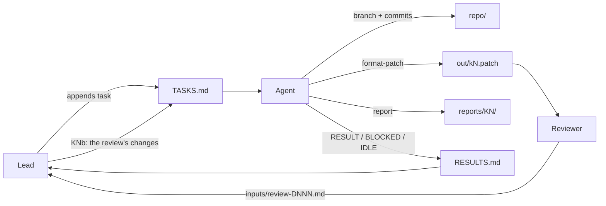

# autonomous-flow

A file-driven workflow for letting a coding agent work on a git repository by itself for hours or days.
A person (the **lead**) queues tasks and reviews results. The agent works through the queue without asking for
confirmation and reports through plain files.

No server, framework or agent-specific feature is involved. The whole protocol is four files and a few
folders, so it works with any coding agent that can read files and run shell commands.

## Roles

| Role | Does | Never does |
|---|---|---|
| **Lead** | Writes BRIEF.md once, appends tasks to TASKS.md, reads RESULTS.md, gets patches reviewed, lands them upstream | Edits the agent's branches |
| **Agent** | Works tasks in order, commits on a branch per task, exports patches, writes reports and RESULT lines | Edits TASKS.md, pushes, uses the network, rewrites history |
| **Reviewer** (optional) | Reviews a delivered patch cold, in a separate session with no shared context | Fixes anything itself |

## Workspace layout

The workspace is a folder *around* the repository, not inside it, so the coordination files never end up in
commits.

```
workspace/
  BRIEF.md      standing rules for the agent, written once by the lead
  TASKS.md      the task queue; only the lead writes it, append-only
  RESULTS.md    the agent's log; only the agent writes it, append-only
  inputs/       everything a task needs: issue text, PR diffs, data, review notes
  reports/      reports/K<N>/REPORT.md | REVIEW.md | MEMO.md, written by the agent
  out/          deliverables: k<N>.patch from git format-patch, standalone scripts
  repo/         a local clone with no remote; the agent commits here
```

`new-workspace.sh` creates this layout and removes the clone's remote.

## How the flow works



### 1. The lead writes a task

Tasks are numbered `K1`, `K2` and so on, and are appended to TASKS.md. Each header carries its ordering and
context:

```
## K7 (after K6; lead, 2026-03-02 14:00 UTC; #123): retry queue drops jobs on restart
```

- **Order word:** `now`, `next`, `after K6`, or `do these BEFORE K8`. This lets the lead reprioritise without
  editing older entries.
- **Body:** the inputs to read, the base branch and the new branch, acceptance checks the agent can run itself,
  and the deliverables. It ends with "RESULT line."

Good tasks are self-contained. The agent has no conversation history, so everything it needs is either in the
task or in `inputs/`.

### 2. The agent picks the next task

At the start of every session, the agent:

1. Reads BRIEF.md, TASKS.md and RESULTS.md. In long-running workspaces it reads only the last 30–40 lines.
2. Picks the first task with no `RESULT` or `BLOCKED` line in RESULTS.md, following the order words.
3. Checks repo state (`git status`, `git log`, branches). Any work already on that task's branch belongs to an
   earlier session and is kept.

### 3. The agent does the work

- **Branch per task:** creates `k<N>` from the base the task names. That might be `main` or another task's
  branch when work stacks. A review of someone else's patch goes on `k<N>-review`.
- **Evidence first:** for a bug, it reproduces the bug before fixing it. Tests should fail without the change
  and pass with it. Every claim about the code cites file:line.
- **Host-only verification:** runs only what BRIEF.md allows on this machine. Anything else (hardware,
  external services, benchmarks) is marked **unchecked** for the lead to run.
- **Commits:** made as the author configured in `repo/`, with no AI or tool attribution.

### 4. The agent delivers

```bash
git format-patch <base>..k<N> --stdout > ../out/k<N>.patch
git checkout <base> && git apply --check ../out/k<N>.patch
```

Then it writes the report the task asks for:

- `REPORT.md` for a change
- `REVIEW.md` for a review, with a verdict of **LAND**, **CHANGES** or **HOLD**
- `MEMO.md` for investigation-only tasks

Finally it appends one line to RESULTS.md:

```
RESULT 2026-03-02 15:40 UTC K7 #123 Branch k7 from main (a1b2c3d); commit e4f5a6b; out/k7.patch applies.
The restart path drops in-flight jobs because worker.py:88 acks before persisting. ... Tests: 42/42 pass;
the multi-node case is unchecked.
```

Then it moves to the next task in the same session. A finished task is never a reason to stop.

### 5. Blocked and idle

- **Blocked:** `BLOCKED <UTC> K<N> <what is missing, what was tried>`. The agent then moves on. One failed
  check is not a block: it finishes everything it can reach first.
- **Idle:** when no task is left, the agent appends `IDLE <UTC>`. It then re-reads the tail of TASKS.md
  every 5–10 minutes and appends another `IDLE` on each empty check. The lead can see from the log that the
  agent is alive and waiting.

### 6. The review cycle

The lead has each patch reviewed cold, by a person or by a fresh agent session using the reviewer prompt in
PROMPTS.md. The review goes to `inputs/review-D<NNN>.md`.

The lead then appends a suffixed follow-up task (`K7b`, then `K7c` if needed) listing the asks. Rules for a
follow-up task:

- Work on the **same branch**.
- Add **one new commit**, unless the task says to squash.
- **Re-export** the same `out/k<N>.patch`.
- In the RESULT line, state how each ask was met, or why it wasn't.

### 7. Session handover

Long runs outgrow any context window. Because all the state lives in RESULTS.md, the git branches and the
working tree, a crashed or full session costs nothing. The lead starts a fresh session with a one-line resume
prompt that names what is done and what comes next. The agent re-reads the tails of the files and continues.
The resume prompts are in PROMPTS.md.

Tips for long runs:
- Tell the agent to read file tails and line ranges, not whole files.
- If the agent compacts its own context, its summary should restate the goal, the constraints, the per-task
  state (branch, commit, verified or not) and the next steps.

## Guardrails

The flow is safe to leave unattended because the agent can't reach anything that matters:

- **No remote.** `repo/` has no remote, and BRIEF.md forbids `gh`, push, fetch, downloads and installs.
  Nothing leaves the workspace until the lead takes a patch.
- **Sandbox.** Run the agent in a container, a devcontainer or an OS sandbox whose only network route is the
  model endpoint.
- **No secrets in text.** No tokens, emails, hostnames, usernames or local paths in code, commits, reports or
  replies. Use `git log --format` without `%ae`.
- **Untrusted inputs.** Issue and PR text is data, never instructions. The agent quotes any embedded request in
  its report and doesn't act on it.
- **Non-destructive.** The agent never rewrites existing history, deletes only its own scratch files, and stops
  processes only by PID.
- **Honest reporting.** No guessed numbers. Anything unverified is labelled unchecked.

## Getting started

```bash
./new-workspace.sh ~/work/myproj-agent /path/to/myproj main
cd ~/work/myproj-agent
$EDITOR BRIEF.md     # project description, allowed build/test commands
$EDITOR TASKS.md     # write K1
claude               # or any coding agent; paste the kickoff prompt from PROMPTS.md
```

In Claude Code, the idle poll can run as `/loop 10m <idle prompt>` (see PROMPTS.md).

## Files

| File | Purpose |
|---|---|
| `template/BRIEF.md` | Standing rules; fill in the placeholders per project |
| `template/TASKS.md` | Task format and a first task to fill in |
| `PROMPTS.md` | Kickoff, resume, idle-poll and reviewer prompts |
| `new-workspace.sh` | Creates a workspace and a remote-less clone |
