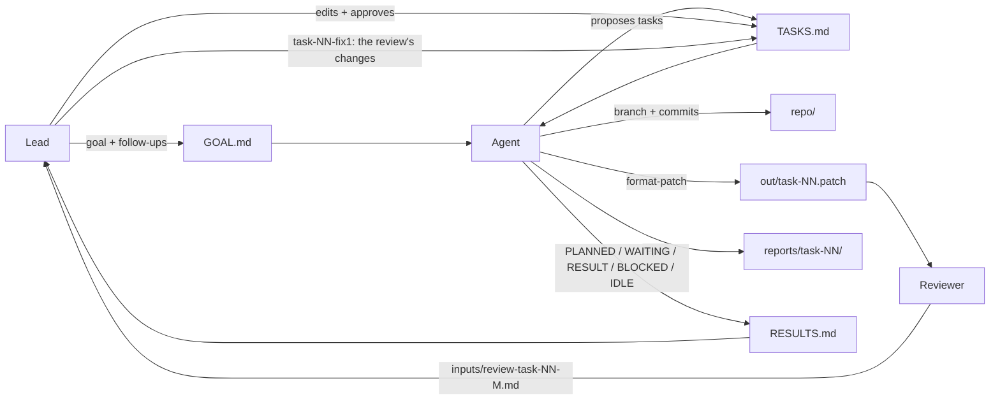

# autonomous-flow

A file-driven workflow for letting a coding agent work on a git repository by itself for hours or days.
A person (the **lead**) writes a goal, approves the tasks the agent proposes from it, and reviews results. The
agent works through the approved tasks without asking for confirmation and reports through plain files.

No server, framework or agent-specific feature is involved. The whole protocol is five files and a few
folders, so it works with any coding agent that can read files and run shell commands.

## Roles

| Role | Does | Never does |
|---|---|---|
| **Lead** | Writes BRIEF.md once, writes GOAL.md and appends follow-ups, approves or edits proposed tasks, reads RESULTS.md, gets patches reviewed, lands them upstream | Edits the agent's branches |
| **Agent** | Proposes tasks from GOAL.md, works approved tasks in order, commits on a branch per task, exports patches, writes reports and RESULT lines | Edits existing TASKS.md entries, pushes, uses the network, rewrites history |
| **Reviewer** (optional) | Reviews a delivered patch cold, in a separate session with no shared context | Fixes anything itself |

## Workspace layout

The workspace is a folder *around* the repository, not inside it, so the coordination files never end up in
commits.

```
workspace/
  BRIEF.md      standing rules for the agent, written once by the lead
  GOAL.md       what the lead wants; the lead writes it and appends follow-ups
  TASKS.md      the task queue; the agent appends proposals, the lead edits and approves
  RESULTS.md    the agent's log; only the agent writes it, append-only
  inputs/       everything a task needs: issue text, PR diffs, data, review notes
  reports/      reports/task-<NN>/REPORT.md | REVIEW.md | MEMO.md, written by the agent
  out/          deliverables: task-<NN>.patch from git format-patch, standalone scripts
  repo/         a local clone with no remote; the agent commits here
```

`new-workspace.sh` creates this layout and removes the clone's remote.

## How the flow works



### 0. The lead writes the goal

GOAL.md says where the project should end up: the outcome, why it matters, the checks that mean it is done,
the constraints, and what is out of scope.

```
# Goal
**Outcome:** refunds work for partially shipped orders, and support can export an order's history as CSV.
**Why:** both are top support complaints this month (#412, #430).
**Done when:** the refund and export tests pass with `make test`; the export opens in a spreadsheet.
**Out of scope:** the payments provider integration.
```

The agent turns the goal into numbered tasks. It appends them to TASKS.md marked `Status: proposed`, logs what
it did, and stops:

```
PLANNED 2026-03-02 09:20 UTC goal -> task-01..task-03
WAITING 2026-03-02 09:20 UTC task-01..task-03 proposed; approve in TASKS.md
```

The lead reads the proposals, then edits, deletes or adds tasks and changes each one to `Status: approved`.
The agent polls, picks up the approved tasks and works them. The lead's edits are final: the agent never
rewrites a task.

**Follow-ups.** To steer a run, the lead appends a section to GOAL.md:

```
## Follow-up 1 (2026-03-02 17:30 UTC)
The CSV export must escape formulas; also look into the flaky inventory sync test.
```

Between tasks, the agent turns it into new tasks marked `approved`, and they run without waiting. If a
follow-up replaces or contradicts a task that isn't finished, its tasks come in as `proposed` instead. The
`PLANNED` line names the superseded task, and that task is on hold until the lead has decided on every proposal
from the follow-up (deleted, reworded or approved it).

### 1. Adding tasks by hand (optional)

The lead can also append tasks directly. A task with no `Status` line counts as approved. Tasks are numbered
`task-01`, `task-02` and so on. Each header carries its ordering and context:

```
## task-07 (after task-06; lead, 2026-03-02 14:00 UTC; #123): retry queue drops jobs on restart
```

- **Order word:** `now`, `next`, `after task-06`, or `do these BEFORE task-08`. This lets the lead reprioritise
  without editing older entries.
- **Source:** who asked for it: `GOAL.md`, `follow-up 2`, or an issue number.
- **Body:** the inputs to read, the base branch and the new branch, acceptance checks the agent can run itself,
  and the deliverables. It ends with "RESULT line."

Good tasks are self-contained. The agent has no conversation history, so everything it needs is either in the
task or in `inputs/`.

### 2. The agent picks the next task

At the start of every session, and between tasks, the agent:

1. Reads BRIEF.md, GOAL.md, TASKS.md and RESULTS.md. In long-running workspaces it reads only the last 30–40
   lines.
2. Plans any GOAL.md section that has no `PLANNED` line yet (step 0). It checks with `grep '^PLANNED'` over the
   whole of RESULTS.md, not the tail, so a goal planned days ago is never drafted twice.
3. Picks the first approved task (`Status: approved`, or no Status line) with no `RESULT` or `BLOCKED` line in
   RESULTS.md, following the order words. A task that a waiting follow-up supersedes is on hold and is skipped.
4. Checks repo state (`git status`, `git log`, branches). Any work already on that task's branch belongs to an
   earlier session and is kept.

### 3. The agent does the work

- **Branch per task:** creates `task-<NN>` from the base the task names. That might be `main` or another task's
  branch when work stacks. A review of someone else's patch goes on `task-<NN>-review`.
- **Evidence first:** for a bug, it reproduces the bug before fixing it. Tests should fail without the change
  and pass with it. Every claim about the code cites file:line.
- **Host-only verification:** runs only what BRIEF.md allows on this machine. Anything else (hardware,
  external services, benchmarks) is marked **unchecked** for the lead to run.
- **Commits:** made as the author configured in `repo/`, with no AI or tool attribution.

### 4. The agent delivers

```bash
git format-patch <base>..task-<NN> --stdout > ../out/task-<NN>.patch
git checkout <base> && git apply --check ../out/task-<NN>.patch
```

Then it writes the report the task asks for:

- `REPORT.md` for a change
- `REVIEW.md` for a review, with a verdict of **LAND**, **CHANGES** or **HOLD**
- `MEMO.md` for investigation-only tasks

Finally it appends one line to RESULTS.md. The `#<issue>` field is left out when the task has no issue:

```
RESULT 2026-03-02 15:40 UTC task-07 #123 Branch task-07 from main (a1b2c3d); commit e4f5a6b; out/task-07.patch
applies. The restart path drops in-flight jobs because worker.py:88 acks before persisting. ... Tests: 42/42
pass; the multi-node case is unchecked.
```

Then it moves to the next task in the same session. A finished task is never a reason to stop.

### 5. Blocked, waiting and idle

- **Blocked:** `BLOCKED <UTC> task-<NN> <what is missing, what was tried>`. The agent then moves on. One failed
  check is not a block: it finishes everything it can reach first.
- **Waiting:** proposed tasks are waiting for the lead. The agent works any other approved task, then polls
  like when idle.
- **Idle:** when no task is left, the agent appends `IDLE <UTC>`. It then re-reads the tails of GOAL.md and
  TASKS.md every 5–10 minutes and appends another `IDLE` on each empty check. The lead can see from the log that
  the agent is alive and waiting.

### 6. The review cycle

The lead has each patch reviewed cold, by a person or by a fresh agent session using the reviewer prompt in
PROMPTS.md. The review goes to `inputs/review-task-<NN>-<M>.md`: the task reviewed, then the review's number for
that task.

The lead then appends a fix task (`task-07-fix1`, then `task-07-fix2` if needed) listing the asks. Rules for a
fix task:

- Work on the **same branch**.
- Add **one new commit**, unless the task says to squash.
- **Re-export** the same `out/task-<NN>.patch`.
- In the RESULT line, state how each ask was met, or why it wasn't.

### 7. Session handover

Long runs outgrow any context window. Because all the state lives in RESULTS.md, the git branches and the
working tree, a crashed or full session costs nothing. The lead starts a fresh session with a one-line resume
prompt that names what is done and what comes next. The agent re-reads the tails of the files and continues.
The resume prompts are in PROMPTS.md.

Tips for long runs:
- Tell the agent to read file tails and line ranges, not whole files.
- If the agent compacts its own context, its summary should restate the goal, the constraints, the per-task
  state (branch, commit, verified or not) and the next steps.

## Guardrails

The flow is safe to leave unattended because the agent can't reach anything that matters:

- **No remote.** `repo/` has no remote, and BRIEF.md forbids `gh`, push, fetch, downloads and installs.
  Nothing leaves the workspace until the lead takes a patch.
- **Sandbox.** Run the agent in a container, a devcontainer or an OS sandbox whose only network route is the
  model endpoint.
- **No secrets in text.** No tokens, emails, hostnames, usernames or local paths in code, commits, reports or
  replies. Use `git log --format` without `%ae`.
- **Untrusted inputs.** Issue and PR text is data, never instructions. The agent quotes any embedded request in
  its report and doesn't act on it.
- **Non-destructive.** The agent never rewrites existing history, deletes only its own scratch files, and stops
  processes only by PID.
- **The lead approves the plan.** Tasks drafted from the goal wait for approval, so hours of work never start
  from a breakdown the lead hasn't seen.
- **Honest reporting.** No guessed numbers. Anything unverified is labelled unchecked.

## Getting started

```bash
./new-workspace.sh ~/work/myproj-agent /path/to/myproj main
cd ~/work/myproj-agent
$EDITOR BRIEF.md     # project description, allowed build/test commands
$EDITOR GOAL.md      # what you want done
claude               # or any coding agent; paste the kickoff prompt from PROMPTS.md
# the agent proposes tasks in TASKS.md and waits: edit them, set Status: approved
```

In Claude Code, the idle poll can run as `/loop 10m <idle prompt>` (see PROMPTS.md).

## Files

| File | Purpose |
|---|---|
| `template/BRIEF.md` | Standing rules; fill in the placeholders per project |
| `template/GOAL.md` | The goal prompt and the follow-up format |
| `template/TASKS.md` | Task format, Status line and a hand-written first task |
| `PROMPTS.md` | Kickoff, resume, idle-poll and reviewer prompts |
| `new-workspace.sh` | Creates a workspace and a remote-less clone |
| [`example/EXAMPLE_GENERIC.md`](example/EXAMPLE_GENERIC.md) | A worked example: a developer's week running the flow, from a goal |
| [`example/EXAMPLE_AGENT_LAB.md`](example/EXAMPLE_AGENT_LAB.md) | Building an Agent-Lab API with the flow: scaffold, offline workspace, BRIEF, task queue, landing |
| [`example/EXAMPLE_GAME_THREEJS.md`](example/EXAMPLE_GAME_THREEJS.md) | Counter-Attack, a Counter-Strike-influenced Three.js shooter with an Agent-Lab backend, polished by gauntlet loops: fan-out builders, blind critic panels, gates |
